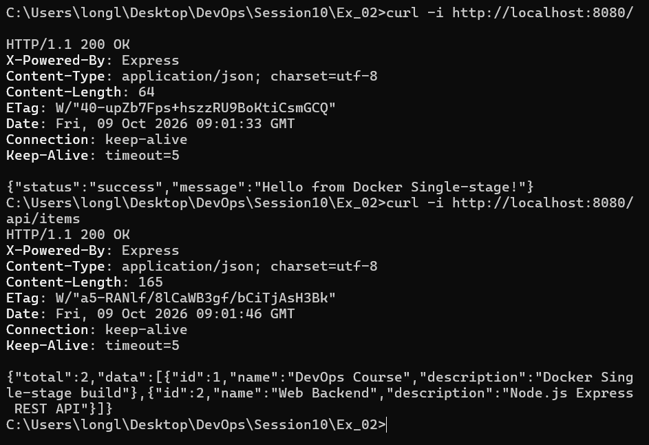

# Bài 2: Đóng gói ứng dụng Web Backend bằng Single-stage Dockerfile

## 1. Giới thiệu
Dự án đóng gói một ứng dụng REST API Web Backend (Node.js/Express) thành Docker Image bằng kỹ thuật Single-stage Dockerfile theo tiêu chuẩn thực hành DevOps.

## 2. Cấu trúc thư mục
```text
Ex_02/
├── Dockerfile          # Tệp cấu hình đóng gói Docker Single-stage
├── .dockerignore       # Loại trừ node_modules và các tệp không cần thiết
├── package.json        # Định nghĩa ứng dụng và dependencies
├── server.js           # Mã nguồn Web API Backend (Express)
└── README.md           # Hướng dẫn chi tiết cách build và chạy
```

---

## 3. Các API Endpoint được hỗ trợ
- `GET /`: Trả về JSON chào mừng (phục vụ kiểm tra chấm điểm theo đề bài).
- `GET /health`: Kiểm tra trạng thái sức khỏe và uptime của server.
- `GET /api/items`: Lấy danh sách toàn bộ items.
- `GET /api/items/:id`: Lấy thông tin chi tiết một item theo ID.
- `POST /api/items`: Thêm mới một item vào hệ thống.

---

## 4. Giải thích các chỉ thị trong Dockerfile

- **`FROM node:18-alpine`**: Sử dụng Image base Node.js 18 trên nền Alpine Linux nhẹ, tối ưu dung lượng và bảo mật.
- **`WORKDIR /app`**: Đặt thư mục làm việc mặc định trong container là `/app`.
- **`ENV PORT=3000`**: Định nghĩa biến môi trường `PORT=3000` cho ứng dụng.
- **`COPY package*.json ./`**: Sao chép tệp danh sách thư viện trước để tận dụng Docker layer caching.
- **`RUN npm install`**: Cài đặt các thư viện cần thiết (`express`).
- **`COPY . .`**: Sao chép toàn bộ mã nguồn ứng dụng vào container.
- **`EXPOSE 3000`**: Khai báo port 3000 mà container sẽ lắng nghe (tài liệu hóa port).
- **`CMD ["node", "server.js"]`**: Lệnh khởi chạy ứng dụng dạng Exec Form tiêu chuẩn.

